# Gym API

API REST para gerenciar uma academia: planos, alunos, instrutores, aulas e equipamentos.

Feita só com Java 21 (JDK puro, `com.sun.net.httpserver`), JDBC, banco H2 embarcado em arquivo e Jackson para JSON. Sem frameworks.

## Modelo

- `Plan` 1..N `Member`
- `Instructor` 1..N `GymClass`
- `Member` N..N `GymClass` (tabela `class_members`)
- `GymClass` N..N `Equipment` (tabela `class_equipment`)
- `Person` (abstrata) é herdada por `Member` e `Instructor`

## Requisitos

- JDK 21 ou superior (`java -version`)
- Não precisa instalar o Maven, o projeto usa o Maven Wrapper (`mvnw`)

## Compilar e gerar o jar

Linux/macOS:

```bash
./mvnw clean package
```

Windows:

```bash
mvnw.cmd clean package
```

O jar fica em `target/gym-api.jar`.

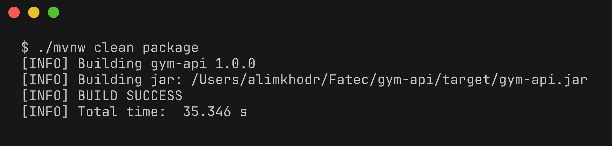

## Executar

```bash
java -jar target/gym-api.jar
```

A API sobe em `http://localhost:8080`. Para usar outra porta: `java -jar target/gym-api.jar 9090`.

O banco é criado automaticamente em `data/gym.mv.db` na primeira execução. Para zerar os dados, apague a pasta `data`.

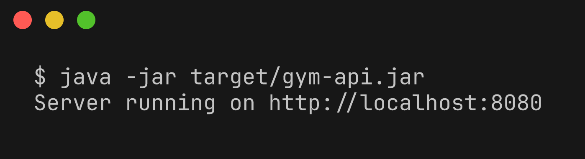

## Endpoints

| Método | Rota | Descrição |
| --- | --- | --- |
| GET, POST | `/plans` | lista / cria planos |
| GET, PUT, DELETE | `/plans/{id}` | busca / atualiza / remove |
| GET | `/plans/{id}/members` | alunos do plano |
| GET, POST | `/members` | lista / cria alunos |
| GET, PUT, DELETE | `/members/{id}` | busca / atualiza / remove |
| GET | `/members/{id}/classes` | aulas do aluno |
| GET, POST | `/instructors` | lista / cria instrutores |
| GET, PUT, DELETE | `/instructors/{id}` | busca / atualiza / remove |
| GET | `/instructors/{id}/classes` | aulas do instrutor |
| GET, POST | `/classes` | lista / cria aulas |
| GET, PUT, DELETE | `/classes/{id}` | busca / atualiza / remove |
| GET | `/classes/{id}/members` | alunos matriculados |
| POST, DELETE | `/classes/{id}/members/{memberId}` | matricula / cancela matrícula |
| GET | `/classes/{id}/equipment` | equipamentos da aula |
| POST, DELETE | `/classes/{id}/equipment/{equipmentId}` | vincula / desvincula equipamento |
| GET, POST | `/equipment` | lista / cria equipamentos |
| GET, PUT, DELETE | `/equipment/{id}` | busca / atualiza / remove |

## Exemplos

Criar plano

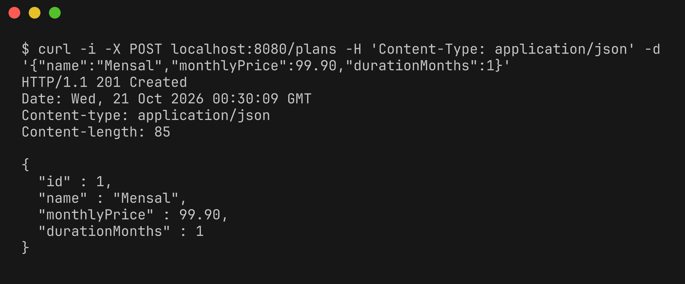

Criar aluno

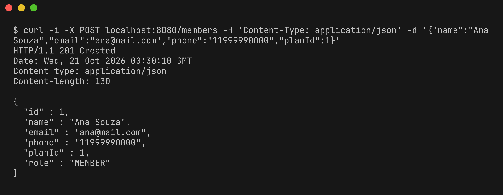

Criar instrutor

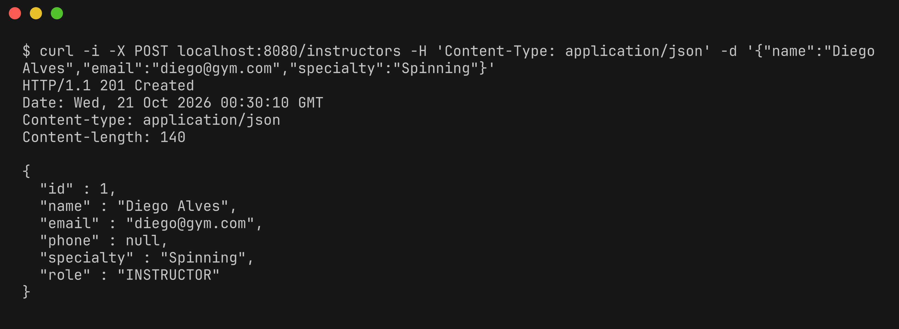

Criar aula

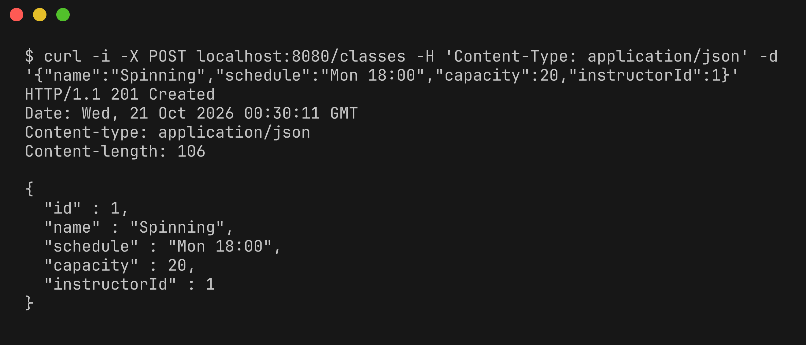

Criar equipamento

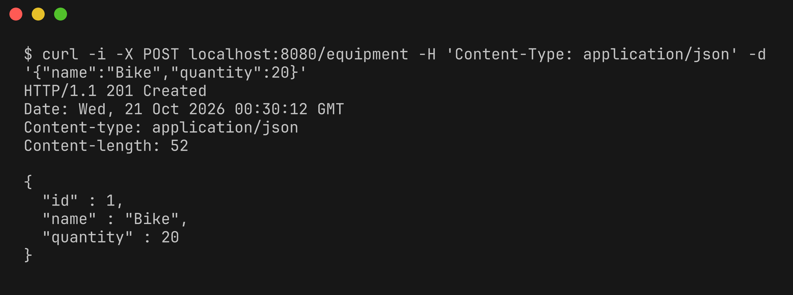

Listar alunos

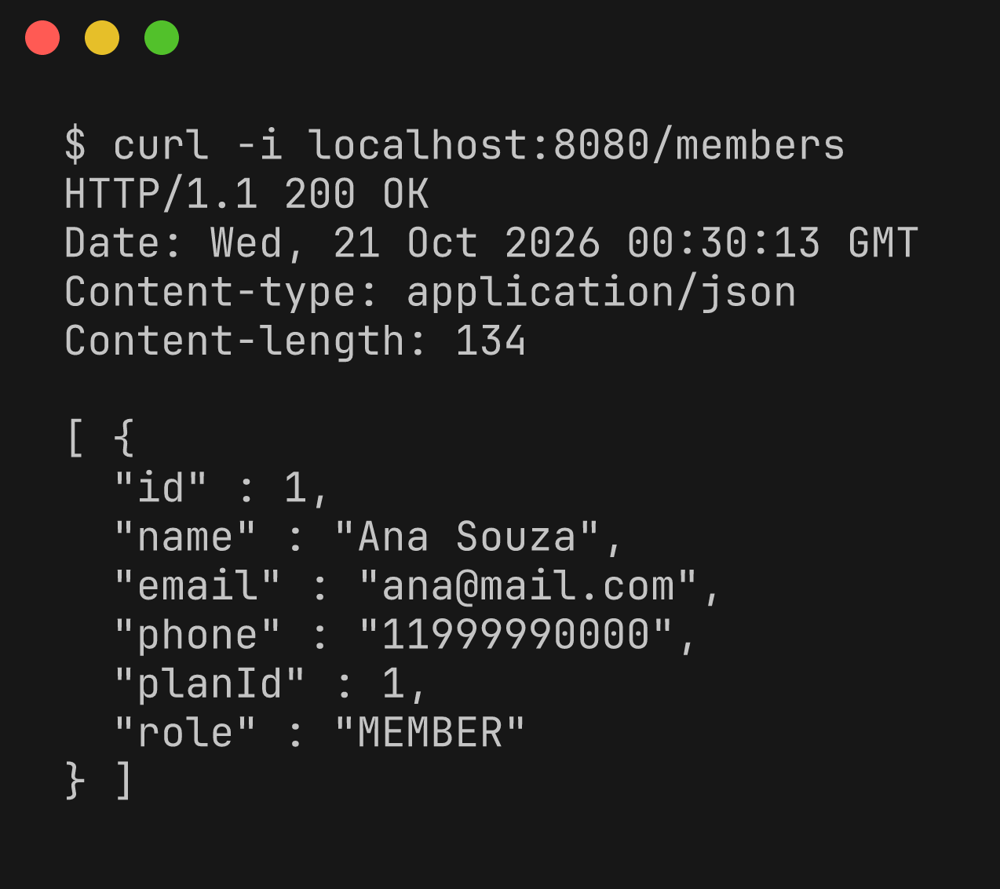

Relacionamentos 1..N

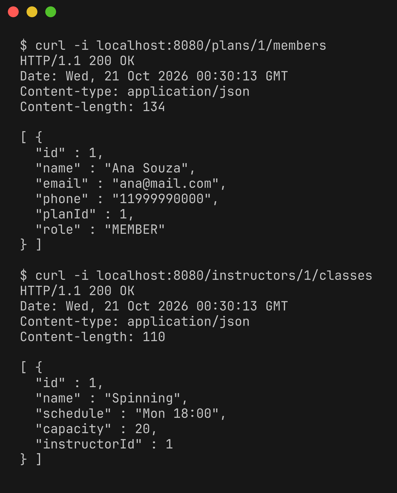

Matrícula (N..N entre aula e aluno)

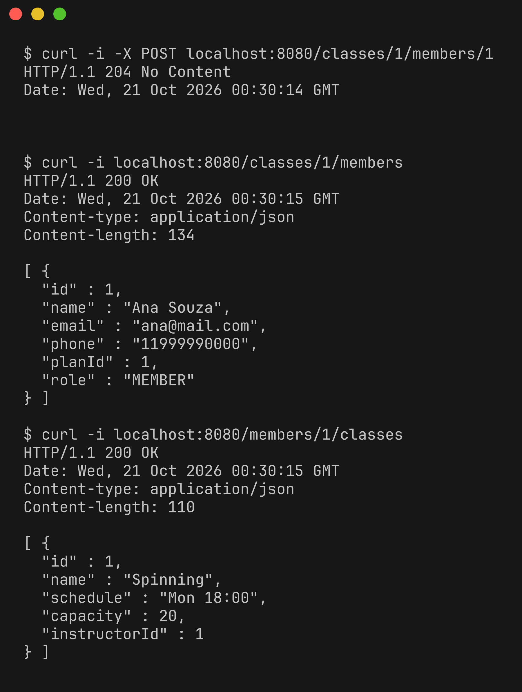

Equipamentos da aula (N..N entre aula e equipamento)

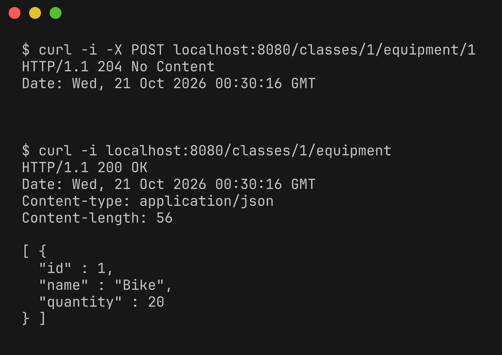

Atualizar

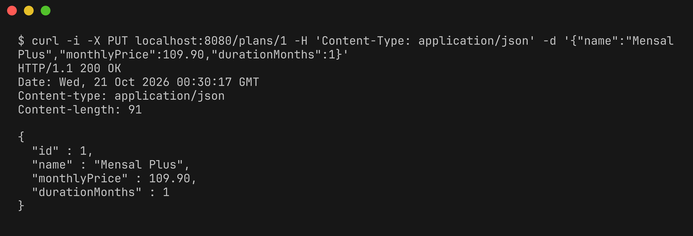

Erros de validação, não encontrado e conflito

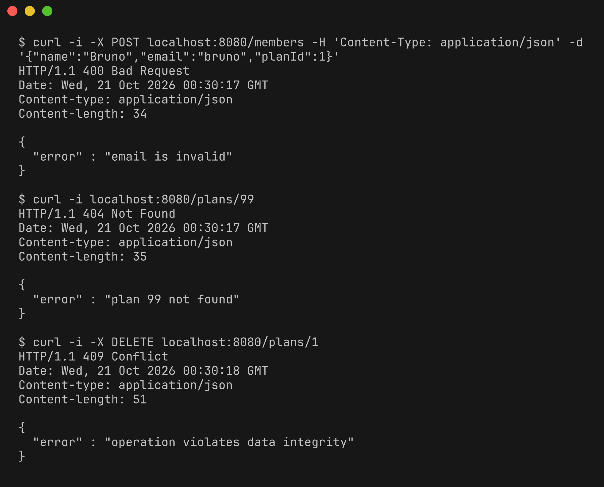

Remover

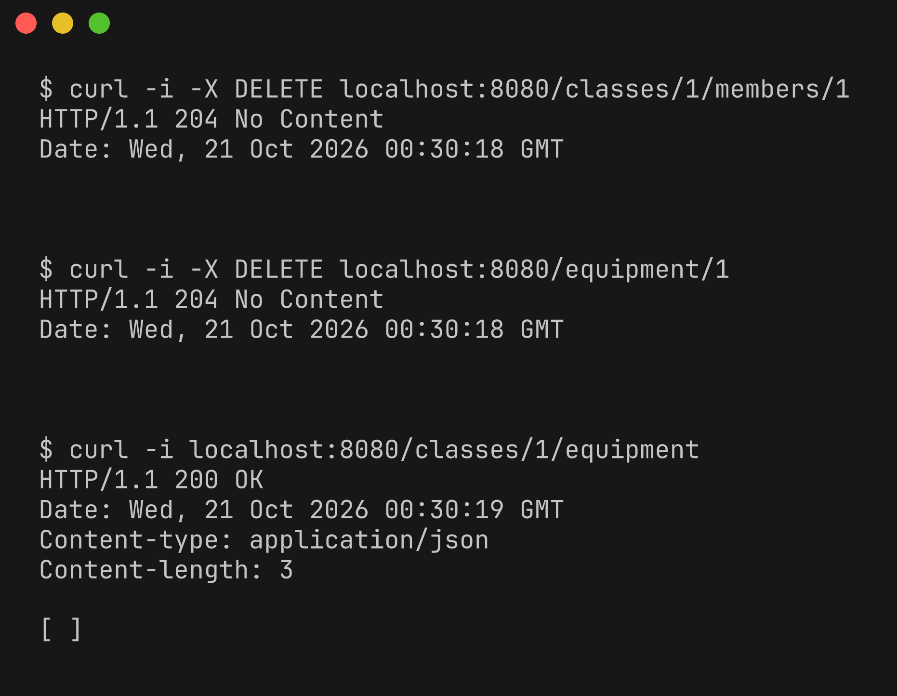
